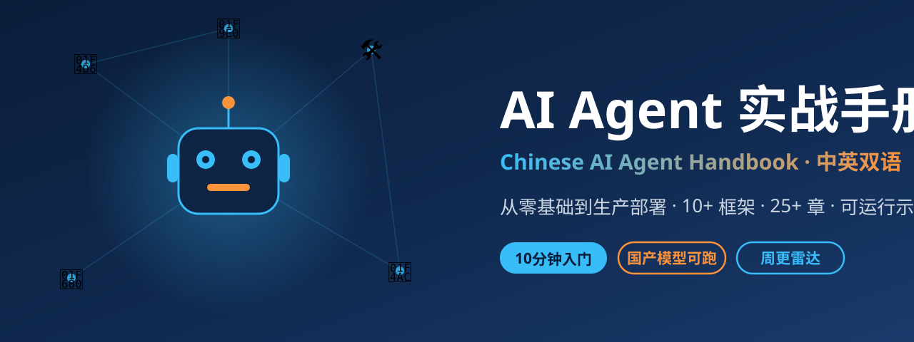
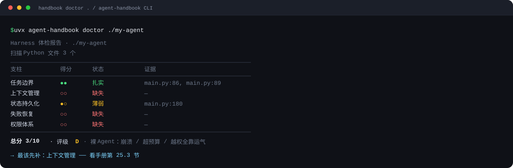

<div align="center">



# AI Agent 实战手册

**31 章中文教程 + 一个能给你项目打分的命令行工具。**
不是教你"会用"某个框架，而是让你看清一个 Agent 项目缺哪根柱子。

[](https://github.com/Xwh630/ai-agent-handbook)
[](https://pypi.org/project/agent-handbook/)
[](https://pypi.org/project/agent-handbook/)
[](LICENSE)

</div>

---

## 30 秒：给你的 Agent 项目做个体检

```bash
uvx agent-handbook doctor .
```

`uvx` 零安装；也可以用 `pipx run agent-handbook doctor .` 或 `pip install agent-handbook`。



大多数「Agent 跑不稳」不是模型不行，而是**第 25 章那五根柱子少了几根**。
`doctor` 静态扫描你的代码，告诉你缺哪根、该读手册的哪一节——把方法论变成可核对的清单。

| 命令 | 干什么 |
|------|--------|
| `handbook doctor .` | 五支柱体检，0–10 分 + 补齐建议 |
| `handbook doctor . --md` | 输出 Markdown 表格，直接贴进 issue / README |
| `handbook search 上下文压缩` | 31 章全文检索，给出章节 + 行号 + 片段 |
| `handbook new my-agent` | 生成自带五支柱的 Agent 骨架（生成即满分） |
| `handbook stars` / `handbook list` / `handbook open 25` | 热度表 / 章节清单 / 章节定位 |

零依赖、纯标准库、离线可用（章节数据随包安装）。

### 放进 CI：分数掉了就让 PR 变红

```yaml
- uses: Xwh630/ai-agent-handbook@main
  with:
    min-score: 6          # 低于 6 分本步骤失败（默认 0 = 只报告不拦）
```

它会把 `--md` 报告贴进 PR 评论，并在 Job Summary 里留一份，评审时能直接看到这次改动动了哪根柱子。

---

## 这本手册解决什么

| 你现在的处境 | 手册给的答案 |
|---|---|
| "Agent 能跑 demo，一上生产就崩" | 第 25 章：任务边界 / 上下文管理 / 状态持久化 / 失败恢复 / 权限体系 |
| "token 费用莫名爆炸" | 第 27 章：一次轮次的 token 构成解剖、压缩三板斧 |
| "团队经验带不进 Agent" | 第 26 章：SKILL.md 六字段规范与渐进式披露 |
| "不知道选哪个框架" | 第 18 章选型决策树 + 第 28 章 2026 顶流全景 |
| "完全没接触过" | 第 0 章：10 分钟跑通第一个 Agent |

**三条阅读路径**

- 🌱 零基础：第 0 章 → 第 1 章 → 第 2 章 → 第 7 章（Dify）
- 💻 会编程：第 2 章 → 框架三选一 → 第 25 章
- 🏗️ 要上生产：第 25 章 → 第 27 章 → 第 26 章 → 第 15 章

---

## 目录

| 编号 | 章节 | 一句话 |
|------|------|--------|
| 00 | [新手快速入门](chapters/00-quickstart.md) | 10 分钟跑通第一个 Agent |
| 01 | [AI Agent 基础概念](chapters/01-fundamentals.md) | Agent 本质、核心组件、ReAct 模式 |
| 02 | [从零手写 ReAct Agent](chapters/02-reaact-from-scratch.md) | 完整实现一个最小可用 Agent |
| 03 | [LangGraph 图编排](chapters/03-langgraph.md) | 复杂工作流、状态机、检查点 |
| 04 | [CrewAI 多智能体](chapters/04-crewai.md) | 角色化团队、任务分配 |
| 05 | [AutoGen / MAF](chapters/05-autogen.md) | 对话驱动协作、迭代求解 |
| 06 | [LlamaIndex RAG](chapters/06-llamaindex-rag.md) | 文档检索、向量数据库 |
| 07 | [Dify 低代码](chapters/07-dify.md) | 可视化拖拽构建应用 |
| 08 | [OpenAI Agents SDK](chapters/08-openai-agents.md) | 轻量级多 Agent |
| 09 | [Claude Agent SDK](chapters/09-claude-agents.md) | Anthropic 官方工具 |
| 10 | [Mastra TypeScript](chapters/10-mastra.md) | TS 优先的 Agent 框架 |
| 11 | [MCP 协议](chapters/11-mcp.md) | 标准化工具连接（含 2026 无状态核心） |
| 12 | [Ollama 本地部署](chapters/12-ollama.md) | 隐私保护、离线场景 |
| 13 | [多 Agent 协作模式](chapters/13-collaboration-patterns.md) | 6 种协作模式与决策树 |
| 14 | [记忆系统与状态管理](chapters/14-memory-state.md) | Mem0、向量记忆、持久化 |
| 15 | [Token 成本优化](chapters/15-cost-optimization.md) | 生产环境成本控制 |
| 16 | [调试与可观测性](chapters/16-observability.md) | LangSmith、日志、追踪 |
| 17 | [全栈实战：研究报告系统](chapters/17-fullstack-project.md) | 整合所有技术的完整项目 |
| 18 | [选型决策树](chapters/18-selection-guide.md) | 如何选择合适的框架 |
| 19 | [Agent 通用工具箱](chapters/19-agent-toolkit.md) | 工具注册中心 / 审批网关 / 成本追踪等六件套 |
| 20 | [Codex CLI](chapters/20-codex-cli.md) | MCP 集成、四种审批模式、沙箱隔离 |
| 21 | [DeepSeek Harness](chapters/21-deepseek-harness.md) | 四种模式、SWE-bench、500+ 插件 |
| 22 | [Continue 编辑器](chapters/22-continue-editor.md) | VSCode / JetBrains 插件 |
| 23 | [Aider 代码助手](chapters/23-aider-codestory.md) | 多模型、Git 集成、会话恢复 |
| 24 | [Trae IDE](chapters/24-trae-ide.md) | AI 原生 IDE 工作流 |
| **25** | [**Harness Engineering**](chapters/25-harness-engineering.md) | **五支柱：2026 年 Agent 上生产的分水岭** |
| **26** | [**Agent Skills 编写实战**](chapters/26-agent-skills.md) | **SKILL.md 六字段规范 + 渐进式披露** |
| **27** | [**上下文工程**](chapters/27-context-engineering.md) | **Context Rot 机理 + 压缩三板斧** |
| 28 | [2026 热门项目全景](chapters/28-trending-2026.md) | 六大顶流串联地图 |
| 29 | [Agent 经济与商业化](chapters/29-agent-economy.md) | x402 / AP2 / Agent Identity |
| 30 | [Agent 评测体系](chapters/30-agent-evals.md) | EDD、三层评测金字塔 |
| 99 | [中英对照术语表](chapters/99-glossary.md) | 130+ 术语通俗解释 |

配套：[11 个可运行示例](examples/) · [Agent Skill 包](skills/agent-handbook/SKILL.md)（装进 Agent 即可查阅全手册）· [PDF 全本](https://github.com/Xwh630/ai-agent-handbook/releases/latest) · [在线站点](https://xwh630.github.io/ai-agent-handbook/)

---

## 📡 Agent Radar 周刊

每周一期，追踪 Agent 圈的新项目、框架版本、协议与玩法。**这是唯一一个每周都会更新的栏目**——想跟进度就 Watch 它。

| 期数 | 日期 | 亮点 |
|------|------|------|
| [第 5 期](radar/2026-W44.md) 🆕 | 2026-10-30 | 评测成为主战场、Agent 间协议互认、Harness 从概念走向榜单 |
| [第 4 期](radar/2026-W43.md) | 2026-10-23 | 终端 Agent 三国杀、上下文压缩工程化、开源评测集升温 |
| [第 3 期](radar/2026-W42.md) | 2026-10-13 | 上下文变成产品：claude-mem、context-mode、OptMem 三条路线 |
| [第 2 期](radar/2026-W41.md) | 2026-10-09 | Skills 时代开启、MCP 无状态化、上下文工程崛起 |
| [第 1 期](radar/2026-W40.md) | 2026-10-02 | Harness 元年、Skills 生态爆发、Computer Use 走向生产 |

> [进入栏目 →](radar/README.md) · 有料要爆料？[开个 Issue](https://github.com/Xwh630/ai-agent-handbook/issues/new?title=Radar投稿：)

---

## 动手跑起来

```bash
git clone https://github.com/Xwh630/ai-agent-handbook.git
cd ai-agent-handbook
pip install -r requirements.txt
cp .env.example .env          # 填 DeepSeek / 智谱 / OpenAI 任一 Key

cd examples/01-react-agent && python main.py
```

不想装 Python？`docker compose up -d && docker compose run dev bash`。

---

## 想参与

- **你的项目用了这本手册？** 提 PR 进 [`projects/`](projects/README.md)，会被收进下一期 Radar 的「社区精选」固定位。
- **发现问题 / 想加章节？** 直接开 [Issue](https://github.com/Xwh630/ai-agent-handbook/issues)，或来 [Discussions](https://github.com/Xwh630/ai-agent-handbook/discussions) 聊。
- **翻译**：英文版进度见 [TRANSLATION_STATUS](en/TRANSLATION_STATUS.md)，目前 4/31 章，欢迎认领。
- 详细规范见 [CONTRIBUTING.md](CONTRIBUTING.md)。

---

## 支持这个项目

这是一个**在校学生用课余时间维护**的项目——写代码、查资料、跟 CI 打架，都在放学后和周末。

如果这份手册帮你少踩了一个坑：

- ⭐ **点个 Star**：它决定我下个周末是继续写第 32 章，还是去写作业
- 👁️ **Watch → Releases only**：每期 Radar 和每个版本都会通知你
- 手册核心**永久免费开源（MIT）**

> 📌 当前版本 **v1.6.0**（2026-10-30）· [更新日志](https://github.com/Xwh630/ai-agent-handbook/releases) · [路线图](ROADMAP.md)

---

## 许可与引用

MIT License，详见 [LICENSE](LICENSE)。用于课程、文章或项目时欢迎引用：

```bibtex
@misc{ai_agent_handbook2026,
  title  = {AI Agent 实战手册 (AI Agent Handbook)},
  author = {Xwh630},
  year   = {2026},
  url    = {https://github.com/Xwh630/ai-agent-handbook},
  note   = {31 章中文教程 + 11 个可运行示例 + agent-handbook CLI}
}
```

<div align="center">

[报告问题](https://github.com/Xwh630/ai-agent-handbook/issues) · [功能建议](https://github.com/Xwh630/ai-agent-handbook/discussions) · [在线文档](https://xwh630.github.io/ai-agent-handbook/)

</div>
